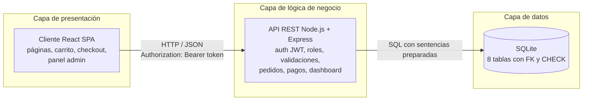
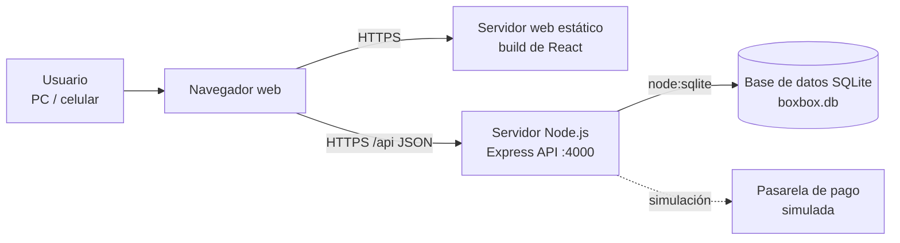
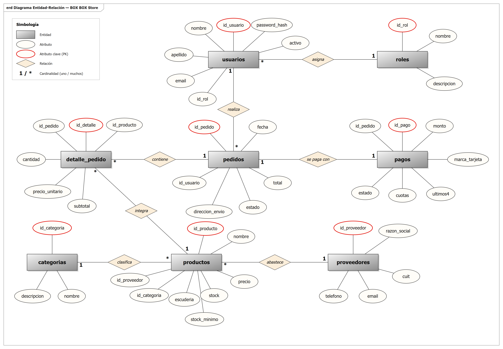
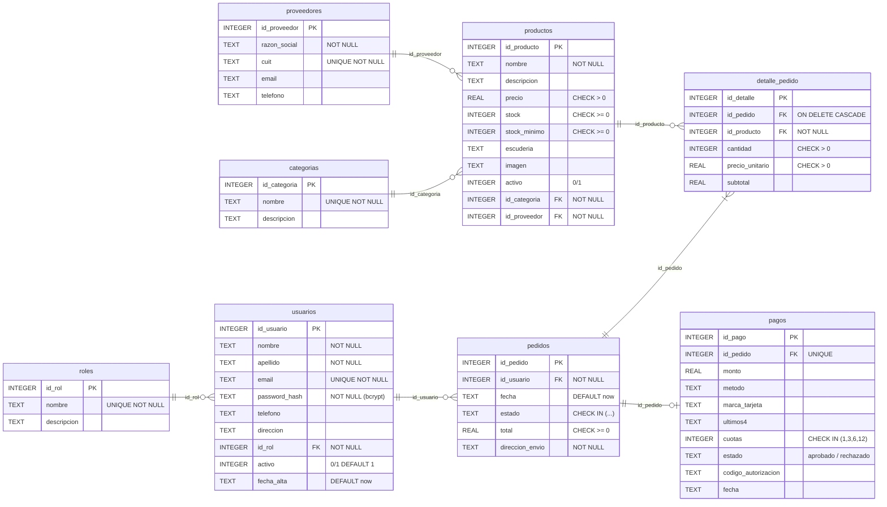
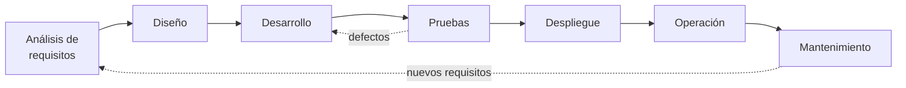

# Documentación integral del sistema e-commerce — BOX BOX Store

**Proyecto:** Tienda online de merchandising de Fórmula 1
**Equipo:** Integrante 1 (Maquetado + Front-End) · Integrante 2 (Documentación + Back-End)
**Versión del documento:** 1.0 — Octubre 2026

---

## Normas, estándares y legislación de referencia

| Norma / Ley | Para qué se utiliza | Partes del documento relacionadas |
|---|---|---|
| **ISO/IEC/IEEE 29148** — Ingeniería de requisitos | Redactar requisitos claros, verificables y trazables (RF/RNF con identificador, prioridad y criterio de aceptación). | 2. Descripción del sistema · Anexo A (Requerimientos) · 7.5 Criterios de aceptación |
| **ISO/IEC/IEEE 42010** — Descripción de arquitecturas | Describir la arquitectura desde varias vistas (lógica, de datos, de despliegue) e identificar stakeholders. | 2.2 Stakeholders · 3. Arquitectura · 4. Diseño de datos |
| **ISO/IEC/IEEE 12207** — Procesos del ciclo de vida del software | Ordenar las etapas de análisis, diseño, desarrollo, pruebas, despliegue, operación y mantenimiento. | 7. Pruebas · 8. Despliegue y operación · 9. Ciclo de vida |
| **ISO/IEC 25010** — Calidad del producto de software | Clasificar los requisitos no funcionales (seguridad, rendimiento, usabilidad, mantenibilidad). | Anexo A (RNF) · 6. Restricciones |
| **Ley 25.326** — Protección de Datos Personales (Argentina) | Tratamiento de datos de clientes (nombre, email, teléfono, dirección): consentimiento, finalidad, seguridad y derecho de acceso/rectificación/supresión. | 2.4 · 6.3 · 6.4 |
| **Ley 24.240** — Defensa del Consumidor y **Res. 424/2020** (botón de arrepentimiento) | Información clara de precios, derecho a revocar la compra en 10 días corridos. | 2.3 · 6.4 · Front-End (footer y “Mis pedidos”) |
| **Código Civil y Comercial, arts. 1105–1116** — Contratos a distancia | Validez de la compra online e información previa obligatoria. | 6.4 |
| **PCI DSS** (estándar de la industria de tarjetas) | Guía para no almacenar datos sensibles de tarjetas (número completo, CVC). | 3.2 · 5 · 6.3 |

**Requisitos legales sobre datos de usuarios:** sí existen. Por la Ley 25.326 los datos personales deben guardarse con medidas de seguridad, usarse solo para gestionar compras y envíos, y el titular puede pedir su rectificación o baja. Por eso el sistema encripta contraseñas, no guarda datos completos de tarjetas y aplica baja lógica de cuentas.

---

## 1. Introducción

### 1.1 Descripción general
BOX BOX Store es una aplicación web de comercio electrónico para la venta de indumentaria y coleccionables de Fórmula 1 (gorras, remeras, buzos, modelos a escala y accesorios). Incluye una tienda pública, un carrito de compras, un módulo de pago con tarjeta (simulado) y un panel administrativo para gestionar productos, stock, pedidos, proveedores y usuarios.

### 1.2 Propósito
Permitir que los fanáticos de la F1 compren productos de sus escuderías favoritas de forma rápida y segura desde cualquier dispositivo, y que el personal de la tienda controle el catálogo, el stock y las ventas desde un único panel.

**Problema que soluciona:** las ventas por redes sociales y mensajes no permiten controlar el stock en tiempo real, generan errores en los pedidos y no dan información de ventas. El sistema centraliza todo y descuenta el stock automáticamente en cada compra.

**A quién está dirigido:** clientes finales (fanáticos), empleados de la tienda y el administrador/dueño.

### 1.3 Alcance
Incluye:
- Registro e inicio de sesión con roles (administrador, empleado, cliente).
- Catálogo con búsqueda y filtro por categoría.
- Carrito persistente y checkout con pago simulado con tarjeta de crédito/débito (hasta 12 cuotas).
- Historial de pedidos del cliente.
- Panel administrativo: dashboard con métricas, CRUD de productos, categorías, proveedores, gestión de pedidos (estados) y de usuarios/permisos.

Fuera de alcance: integración con una pasarela de pago real (Mercado Pago, etc.), facturación electrónica AFIP, cálculo de costo de envío por correo y notificaciones por email (quedan como mejoras futuras).

### 1.4 Objetivos de la documentación
- Explicar **qué hace** el sistema, **cómo está construido** y **por qué** se tomaron las decisiones de diseño.
- Servir de guía para que otro desarrollador pueda **instalarlo, mantenerlo y ampliarlo** sin depender de los autores.
- Registrar requisitos, modelo de datos, pruebas y procedimientos de despliegue para la **evaluación y defensa** del proyecto.
- Destinatarios: docentes evaluadores, desarrolladores que mantengan el sistema y el administrador del negocio.

---

## 2. Descripción del sistema

### 2.1 Objetivo del sistema
Gestionar la venta online de productos de motorsport desde la consulta del catálogo hasta la entrega del pedido, manteniendo el stock actualizado y brindando información de ventas para la toma de decisiones.

### 2.2 Stakeholders

| Stakeholder | Rol en el sistema | Qué hace |
|---|---|---|
| Cliente | `cliente` | Consulta el catálogo, compra, paga y consulta sus pedidos. |
| Empleado de la tienda | `empleado` | Modifica productos, **controla el stock**, **gestiona las ventas** (cambia estados de pedidos), administra categorías y proveedores. |
| Administrador / dueño | `admin` | Todo lo del empleado + **administra el sistema**: usuarios, roles y permisos. Consulta métricas del dashboard. |
| Visitante (sin cuenta) | — | **Consulta información**: catálogo y detalle de productos. |
| Proveedores | Entidad de datos | Abastecen productos; se registran para saber a quién reponer. |
| Entidad emisora de la tarjeta | Externa (simulada) | Aprueba o rechaza el pago. |
| Equipo de desarrollo / docentes | — | Mantienen y evalúan el sistema. |

### 2.3 Funciones principales
- **Cliente:** registrarse, iniciar sesión, buscar y filtrar productos, ver detalle, agregar al carrito, modificar cantidades, pagar con tarjeta en 1/3/6/12 cuotas, ver su historial de pedidos y el estado de cada uno.
- **Administrador / empleado:** ver el dashboard (ventas totales, del mes, por categoría, por día, productos más vendidos, alertas de stock bajo); alta, baja lógica y modificación de productos; CRUD de categorías y proveedores; cambiar estado de pedidos; cancelar pedidos (devuelve stock).
- **Solo administrador:** crear usuarios, cambiar roles y habilitar/deshabilitar cuentas.
- **Gestión de productos:** cada producto pertenece a una categoría y a un proveedor; tiene precio, stock y stock mínimo.
- **Gestión de stock:** el stock se descuenta automáticamente al confirmar un pago y se repone al cancelar un pedido. Cuando `stock <= stock_mínimo` aparece en “Alertas de stock” y en la tienda se muestra “Últimas unidades”.
- **Compra:** carrito → login → checkout → validación de stock → pago → registro del pedido, detalle y pago en una única transacción.
- **Pedidos:** estados `pendiente → pagado → enviado → entregado` o `cancelado`.
- **Notificaciones:** mensajes en pantalla de pago aprobado (con código de autorización) o rechazado (con el motivo), avisos de stock bajo en el panel y de “Últimas unidades / Agotado” en la tienda.

### 2.4 Restricciones generales
- **Dispositivos:** PC, notebook, tablet y celular (diseño responsive desde 360 px).
- **Navegadores:** Chrome, Edge, Firefox y Safari en sus dos últimas versiones.
- **Rendimiento:** respuestas de la API < 500 ms en condiciones normales.
- **Seguridad:** contraseñas con bcrypt, autenticación JWT, control de acceso por rol en el servidor.
- **Normativa:** Ley 25.326, Ley 24.240, Res. 424/2020.
- **Información a proteger:** contraseñas, datos personales, datos de tarjetas (no se almacenan completos).

---

## 3. Arquitectura del sistema

### 3.1 Estilo arquitectónico
Arquitectura **cliente-servidor en tres capas** con una **API REST**:



- **Presentación:** React (Single Page Application) en el navegador.
- **Lógica de negocio:** API REST en Node.js/Express; valida, aplica reglas de negocio y permisos.
- **Datos:** base de datos relacional SQL (SQLite), con claves foráneas y restricciones `CHECK`.

Los componentes se comunican por HTTP con mensajes JSON. La autenticación viaja en el header `Authorization: Bearer <token>`.

### 3.2 Componentes principales

| Capa | Tecnología | Detalle |
|---|---|---|
| Front-End | React 18, React Router 6, Vite 5 | SPA con rutas públicas, rutas protegidas por rol y panel admin. |
| Módulo de tarjeta | `react-credit-cards-2` (fork mantenido de `amaroteam/react-credit-cards`) | Muestra la tarjeta animada mientras se cargan los datos. |
| Estado global | React Context | `AuthContext` (sesión) y `CartContext` (carrito en localStorage). |
| Back-End | Node.js 22+, Express 4 | Rutas: `/auth`, `/productos`, `/categorias`, `/proveedores`, `/pedidos`, `/usuarios`, `/dashboard`. |
| Base de datos | SQLite mediante el módulo nativo `node:sqlite` | Archivo `backend/data/boxbox.db`. No requiere instalar un servidor. |
| Seguridad | `bcryptjs`, `jsonwebtoken` | Hash de contraseñas (10 rondas de sal) y tokens JWT de 8 h. |
| Pruebas | Jest + Supertest | 22 pruebas automatizadas sobre la API. |

**Login:** el usuario envía email y contraseña → el servidor busca el usuario, compara la contraseña con `bcrypt.compare` → si coincide y la cuenta está activa, firma un JWT con `{id, email, rol}` → el front lo guarda y lo envía en cada pedido.

**Almacenamiento de contraseñas:** nunca en texto plano. Se guarda solo el hash bcrypt (`$2a$10$...`), que incluye una sal aleatoria; no se puede revertir.

**Módulos:** Autenticación · Catálogo · Carrito · Pagos (simulado) · Pedidos · Administración (productos, categorías, proveedores, usuarios) · Dashboard.

### 3.3 Diagrama de despliegue



Flujo: **Usuario → Navegador → React → Node.js/API → SQL**. En desarrollo todo corre en la misma PC (React en `localhost:5173`, API en `localhost:4000`, la base es un archivo local). En producción el front se sirve como archivos estáticos y la API corre en un servidor Node.

### 3.4 Escalabilidad y rendimiento
- **Más usuarios:** la API no guarda estado de sesión (JWT), por lo que se pueden levantar varias instancias detrás de un balanceador de carga.
- **Más productos/pedidos:** índices en las claves foráneas (`idx_productos_categoria`, `idx_pedidos_usuario`, `idx_detalle_pedido`); el catálogo filtra en SQL y no en memoria.
- **Optimización de consultas:** sentencias preparadas, `JOIN` en lugar de consultas repetidas, agregaciones (`SUM`, `COUNT`) resueltas en la base.
- **Ampliar el servidor:** migrar de SQLite a MySQL/PostgreSQL (el SQL usado es estándar) cuando haya muchas escrituras concurrentes; escalar verticalmente (más CPU/RAM) u horizontalmente.
- **Reducir tiempo de respuesta:** build de React minificado y comprimido (gzip ≈ 72 kB de JS), caché de archivos estáticos, paginación del catálogo como mejora futura.

---

## 4. Diseño de datos

Información que almacena el sistema: usuarios y sus roles, catálogo (productos, categorías, proveedores), pedidos con su detalle y el pago asociado.

### 4.1 Diagrama Entidad-Relación (DER)



Notación de Chen: rectángulo = entidad, elipse = atributo, elipse roja = clave primaria (PK), rombo = relación; cardinalidades 1 (uno) y * (muchos).

Relaciones y cardinalidades:
- **Usuario – Pedido (1:N):** un usuario puede realizar muchos pedidos; cada pedido pertenece a un solo usuario.
- **Producto – Categoría (N:1):** cada producto pertenece a una categoría; una categoría agrupa muchos productos.
- **Producto – Proveedor (N:1):** cada producto lo abastece un proveedor; un proveedor puede abastecer muchos productos.
- **Pedido – DetallePedido (1:N):** un pedido tiene uno o más renglones de detalle; cada detalle pertenece a un pedido. La relación N:M entre Pedido y Producto se resuelve con DetallePedido.
- **Rol – Usuario (1:N)** y **Pedido – Pago (1:1)**.

### Diagrama de base de datos (modelo físico)



El script completo está en [`backend/src/schema.sql`](../backend/src/schema.sql).

### 4.2 Descripción de entidades

| Entidad | Qué representa | PK | FK | Atributos importantes |
|---|---|---|---|---|
| **Rol** | Nivel de permiso | `id_rol` | — | `nombre`: admin / empleado / cliente. |
| **Usuario** | Persona con cuenta | `id_usuario` | `id_rol → roles` | `email` (único, sirve de usuario de login), `password_hash` (bcrypt), `activo` (baja lógica), `direccion` (envío por defecto). |
| **Categoría** | Agrupación del catálogo | `id_categoria` | — | `nombre` único (Gorras, Remeras…). |
| **Proveedor** | Empresa que abastece | `id_proveedor` | — | `cuit` único, datos de contacto para reponer stock. |
| **Producto** | Artículo a la venta | `id_producto` | `id_categoria`, `id_proveedor` | `precio`, `stock`, `stock_minimo` (umbral de alerta), `escuderia`, `activo` (baja lógica). |
| **Pedido** | Compra de un cliente | `id_pedido` | `id_usuario → usuarios` | `estado`, `total` (calculado en el servidor), `direccion_envio`, `fecha`. |
| **DetallePedido** | Renglón del pedido | `id_detalle` | `id_pedido`, `id_producto` | `cantidad`, `precio_unitario` (precio histórico al momento de la compra), `subtotal`. |
| **Pago** | Cobro del pedido | `id_pago` | `id_pedido → pedidos` | `marca_tarjeta`, `ultimos4` (nunca el número completo ni el CVC), `cuotas`, `estado`, `codigo_autorizacion`. |

### 4.3 Reglas de integridad
- **¿Puede existir un pedido sin usuario?** No: `id_usuario NOT NULL` + FK.
- **¿Puede existir un detalle sin pedido?** No: `id_pedido NOT NULL` + FK con `ON DELETE CASCADE`.
- **¿Puede existir un producto sin categoría?** No: `id_categoria NOT NULL` + FK. Tampoco se puede borrar una categoría con productos (la API responde 409).
- **¿Puede existir stock de un producto inexistente?** No: el stock es un atributo del propio producto.
- **¿Se permiten cantidades negativas?** No: `CHECK (stock >= 0)`, `CHECK (cantidad > 0)`, `CHECK (precio > 0)`; además se valida en la API y en el formulario.
- **¿Las claves primarias son únicas?** Sí: `INTEGER PRIMARY KEY AUTOINCREMENT`. También son únicos `email`, `cuit`, nombre de categoría y de rol.
- Integridad referencial activada con `PRAGMA foreign_keys = ON`.
- Las operaciones de compra y cancelación usan **transacciones** (`BEGIN / COMMIT / ROLLBACK`): o se guarda todo (pedido + detalle + pago + descuento de stock) o nada.

### 4.4 Migración y respaldo
- **Cambios en la estructura:** se hacen en `schema.sql` con sentencias `CREATE TABLE IF NOT EXISTS` / `ALTER TABLE`, versionadas en Git: cada cambio queda registrado en el historial de commits con su autor y fecha. Como mejora se puede incorporar una herramienta de migraciones (Knex / Prisma Migrate).
- **Respaldos:** como SQLite es un único archivo, el respaldo es copiar `boxbox.db` (o `sqlite3 boxbox.db ".backup backup.db"` en caliente). Frecuencia propuesta: diario automático (tarea programada) + antes de cada despliegue. Se guardan 7 diarios y 4 semanales en un almacenamiento externo (Google Drive / bucket en la nube).
- **Recuperación ante fallas:** detener la API, reemplazar `boxbox.db` por el último respaldo válido y reiniciar. Si se borra la base, al iniciar el sistema la recrea vacía con los datos iniciales.

---

## 5. Comportamiento del sistema

### 5.1 Escenarios principales

**Registro de usuario**
1. El visitante completa nombre, apellido, email y contraseña (dos veces).
2. El front valida formato y que las contraseñas coincidan.
3. La API valida campos obligatorios, formato de email, fortaleza de contraseña y que el email no exista.
4. Guarda el usuario con rol `cliente` y la contraseña encriptada; devuelve un token → el usuario queda logueado.
5. Error: email repetido (409) o contraseña débil (400) → se muestra el mensaje en el formulario.

**Consulta de producto:** el visitante entra a la tienda, filtra por categoría o busca por nombre/escudería; la API devuelve solo productos activos. En el detalle se muestra precio, cuotas y stock disponible; si el stock es 0 se deshabilita la compra.

**Agregar al carrito:** se guarda en el navegador (localStorage); la cantidad nunca supera el stock disponible.

**Confirmar compra (checkout)**
1. El cliente (logueado) carga los datos de la tarjeta, elige cuotas y dirección de envío.
2. La API, dentro de una transacción: verifica que cada producto exista y esté activo → verifica stock → calcula el total con los **precios de la base** (ignora precios enviados por el cliente) → procesa el pago simulado.
3. Si el pago se aprueba: crea el pedido (`pagado`), los detalles, el registro de pago (solo últimos 4 dígitos) y descuenta stock. Responde 201 con el código de autorización.
4. Se vacía el carrito y se muestra la confirmación.

**Falta de stock:** la API responde `409 Stock insuficiente para "X" (disponible: N)` y no se registra nada.

**Pago rechazado:** responde `402` con el motivo (fondos insuficientes / tarjeta denunciada); no se crea el pedido ni se toca el stock.

**Cancelación (empleado/admin):** al pasar un pedido a `cancelado` se devuelve el stock de todos sus productos.

### 5.2 Inicio de sesión
1. El usuario ingresa email y contraseña.
2. La API busca el email (normalizado a minúsculas) y compara la contraseña con bcrypt.
3. Si no coincide → `401 Email o contraseña incorrectos` (mismo mensaje para ambos casos, para no revelar qué emails existen).
4. Si la cuenta está deshabilitada → `403`.
5. Si es correcto → devuelve un JWT (8 h) y los datos públicos del usuario (sin el hash).
6. El front guarda el token y redirige: admin/empleado al **Panel**, cliente a la **Tienda**.
7. Las rutas protegidas verifican el token y el rol **en el servidor** (401 sin sesión, 403 sin permiso) y también en el front (oculta menús y muestra “Acceso denegado”).

### 5.3 Validaciones

| Dato | Regla | Front | Back |
|---|---|---|---|
| Email | Obligatorio, formato `x@y.z`, único | ✓ (`type=email`) | ✓ |
| Contraseña | ≥ 8 caracteres, mayúscula, minúscula y número | ✓ | ✓ |
| Precio | > 0 | ✓ (`min=1`) | ✓ + `CHECK` |
| Stock | Entero ≥ 0 | ✓ | ✓ + `CHECK` |
| Categoría / proveedor | Deben existir | ✓ (select) | ✓ + FK |
| Número de tarjeta | 13–19 dígitos, algoritmo de Luhn | formato | ✓ |
| Vencimiento | MM/AA, no vencida | formato | ✓ |
| CVC | 3 dígitos (4 en Amex) | ✓ | ✓ |
| Cuotas | 1, 3, 6 o 12 | ✓ (select) | ✓ + `CHECK` |
| Cantidad en carrito | Entero > 0 y ≤ stock | ✓ | ✓ |

Siempre **se valida nuevamente en el servidor**: el front solo mejora la experiencia, nunca es la única barrera.

### 5.4 Manejo de errores
- **Errores posibles:** datos inválidos (400), sin sesión (401), sin permiso (403), no encontrado (404), conflicto: email duplicado, stock insuficiente, categoría en uso (409), pago rechazado (402), error interno (500), API caída.
- **Cómo se informa al usuario:** mensajes claros en español dentro del formulario o la página (cajas rojas de alerta). Si la API no responde: “No se pudo conectar con el servidor”.
- **Qué se registra:** los errores 500 se escriben en el log del servidor con fecha, método y URL.
- **Información sensible:** un middleware centralizado convierte cualquier error no controlado en `500 Error interno del servidor`, sin mostrar el stack ni consultas SQL. Las respuestas nunca incluyen `password_hash`. El login no revela si el email existe.

---

## 6. Restricciones del diseño

### 6.1 Compatibilidad
- Navegadores: Chrome, Edge, Firefox, Safari (últimas 2 versiones). Sin soporte para Internet Explorer.
- Sistemas operativos: Windows 10/11, macOS, Linux, Android 10+, iOS 15+.
- Resoluciones: desde 360 px (celular) hasta 1920 px; puntos de quiebre en 640 px y 900 px.
- Dispositivos: PC, notebook, tablet y celular.

### 6.2 Rendimiento
- Tiempo de respuesta de la API: < 500 ms (medido en pruebas locales: < 20 ms por endpoint).
- Carga inicial del front: < 3 s en 4G (≈ 115 kB comprimidos).
- Memoria del servidor: ~60–100 MB en Node.js.
- Usuarios concurrentes estimados: ~100 con SQLite en un servidor de 1 vCPU / 1 GB RAM; para más, migrar a MySQL/PostgreSQL.

### 6.3 Seguridad
- **Autenticación:** JWT firmado con secreto en variable de entorno, vencimiento 8 h.
- **Autorización:** middleware `requireRole` por ruta: cliente / empleado / admin.
- **Contraseñas:** bcrypt con 10 rondas de sal; política de contraseña fuerte.
- **Datos personales:** solo se piden los necesarios para el envío; baja lógica de cuentas.
- **Tarjetas:** no se almacenan número completo ni CVC; solo marca y últimos 4 dígitos.
- **Protección de la información:** consultas preparadas (evitan SQL Injection), React escapa el HTML (evita XSS), CORS restringido al origen del front, tamaño máximo de JSON 100 kB, HTTPS obligatorio en producción.

### 6.4 Normativas aplicables
- **Ley 25.326** de Protección de Datos Personales y su autoridad de aplicación (AAIP).
- **Ley 24.240** de Defensa del Consumidor: precios finales visibles, información del producto.
- **Resolución 424/2020** (Secretaría de Comercio Interior): botón de arrepentimiento visible en el sitio (implementado en el footer y en “Mis pedidos”).
- **Código Civil y Comercial**, arts. 1105–1116: contratos celebrados a distancia; derecho de revocación de 10 días.
- **PCI DSS** como buena práctica para datos de tarjetas.

### 6.5 Limitaciones tecnológicas
- SQLite admite un solo escritor a la vez: adecuado para una tienda chica/mediana, no para alto volumen.
- El pago es una **simulación**: no hay comunicación con bancos.
- Requiere Node.js 22.5 o superior (por el módulo `node:sqlite`).
- Las imágenes de productos son ilustraciones vectoriales generadas por el sistema (no hay subida de fotos).
- Dependencia de conexión a internet para el usuario final y de Google Fonts para la tipografía (con tipografía de respaldo del sistema).

---

## 7. Pruebas y validaciones

### 7.1 Pruebas unitarias
- **Qué se prueba:** las funciones de la pasarela de pago (`backend/src/utils/payment.js`): algoritmo de Luhn, detección de marca, validación de vencimiento y reglas de aprobación/rechazo.
- **Framework:** **Jest**.
- **Resultado esperado:** que cada función devuelva el valor correcto para casos válidos e inválidos (ej.: `luhnValid('4242 4242 4242 4242') === true`).
- **Pasa o falla:** Jest compara el valor real con el esperado mediante `expect(...).toBe(...)`; si alguna comparación no coincide, la prueba falla y se muestra la diferencia.

### 7.2 Pruebas de integración
Las pruebas con Supertest levantan la aplicación Express completa conectada a una base SQLite **en memoria** con los datos de ejemplo, por lo que verifican en conjunto **API + lógica + SQL**:
- Los datos enviados llegan y se guardan (ej.: después de comprar se consulta la tabla `productos` y se verifica el stock descontado).
- Las respuestas son las esperadas (códigos HTTP y cuerpo JSON).
- **React con la API:** verificado manualmente recorriendo el flujo completo en el navegador (login → carrito → pago rechazado → pago aprobado → dashboard).

### 7.3 Pruebas de API

| Método | Endpoint | Acceso | Recibe | Respuesta |
|---|---|---|---|---|
| POST | `/api/auth/register` | Público | nombre, apellido, email, password | 201 `{token, user}` · 400 · 409 |
| POST | `/api/auth/login` | Público | email, password | 200 `{token, user}` · 401 · 403 |
| GET | `/api/auth/me` | Logueado | — | 200 usuario · 401 |
| GET | `/api/productos?q=&categoria=` | Público | filtros | 200 lista |
| GET | `/api/productos/:id` | Público | — | 200 · 404 |
| POST / PUT | `/api/productos[/:id]` | Admin, empleado | datos del producto | 201/200 · 400 · 403 · 404 |
| DELETE | `/api/productos/:id` | Admin, empleado | — | 204 (baja lógica) · 404 |
| GET/POST/PUT/DELETE | `/api/categorias` | Lectura pública; escritura staff | nombre, descripción | 200/201/204 · 409 si tiene productos |
| GET/POST/PUT/DELETE | `/api/proveedores` | Admin, empleado | razón social, CUIT… | 200/201/204 · 409 |
| POST | `/api/pedidos` | Logueado | items, direccion_envio, cuotas, tarjeta | 201 pedido · 400 · 402 · 404 · 409 |
| GET | `/api/pedidos/mios` | Logueado | — | 200 pedidos propios |
| GET | `/api/pedidos` | Admin, empleado | — | 200 todos |
| PATCH | `/api/pedidos/:id/estado` | Admin, empleado | estado | 200 · 400 · 409 |
| GET/POST/PUT/DELETE | `/api/usuarios` | Solo admin | datos, id_rol, activo | 200/201/204 · 400 · 403 |
| GET | `/api/dashboard` | Admin, empleado | — | 200 métricas |
| GET | `/api/health` | Público | — | 200 `{status: ok}` |

**Herramienta:** **Postman** para pruebas manuales (colección con login y uso de la variable `{{token}}` en el header `Authorization`). **Ante datos incorrectos** la API responde 400 con `{ "error": "mensaje" }`.

### 7.4 Supertest
- **Qué es:** una librería que permite hacer pedidos HTTP a una aplicación Express sin levantar un servidor real.
- **Para qué se usa:** automatizar las pruebas de la API (lo mismo que se hace a mano con Postman, pero repetible con un comando).
- **Cómo se combina con Jest:** Jest organiza y ejecuta las pruebas (`describe`, `test`, `expect`) y Supertest hace los pedidos: `await request(app).post('/api/auth/login').send({...})`, luego `expect(res.status).toBe(200)`.
- **Endpoints probados:** registro, login, permisos del dashboard, CRUD completo de productos, compra aprobada, compra rechazada, stock insuficiente, tarjeta inválida, compra sin sesión y cancelación de pedido.

**Pruebas implementadas (22, todas aprobadas):**

| Archivo | Pruebas |
|---|---|
| `tests/auth.test.js` | Registro con contraseña encriptada (bcrypt) · rechazo de contraseña débil y email duplicado · login correcto/incorrecto · cliente sin acceso al panel (403) y sin token (401) |
| `tests/products.test.js` | Catálogo público · crear · leer · actualizar · validaciones (precio/stock negativos, categoría inexistente) · baja lógica · cliente no puede crear (403) |
| `tests/orders.test.js` | Pago aprobado (total con precios de la BD, descuento de stock) · no se guarda el número de tarjeta · pago rechazado (402, sin cambios) · stock insuficiente (409) · tarjeta inválida/vencida (400) · compra sin sesión (401) · cancelación devuelve stock |
| `tests/payment.test.js` | Luhn · marca de tarjeta · vencimiento · aprobación/rechazo |

Ejecución: `npm test` (desde la raíz o desde `backend/`).

### 7.5 Criterios de aceptación

**Generación de pedidos** — se aprueba si:
- El usuario está autenticado.
- El carrito contiene productos.
- Los productos existen y están activos.
- Hay stock suficiente.
- El pago fue aprobado.
- El pedido se guarda con estado `pagado`.
- Se registran los detalles con el precio unitario del momento.
- El stock se descuenta.
- El total se calcula correctamente con precios de la base.
- El usuario recibe la confirmación con el número de pedido y el código de autorización.

**Login con permisos** — se aprueba si un usuario válido obtiene un token, uno inválido recibe 401, y cada rol solo accede a sus secciones (403 en caso contrario).

**CRUD de productos** — se aprueba si se puede crear, listar, editar y dar de baja un producto, y los datos inválidos son rechazados.

Si una condición falla, la funcionalidad **no se considera terminada**: se registra el defecto, se corrige y se vuelven a correr **todas** las pruebas. Una funcionalidad está finalizada cuando cumple sus criterios, sus pruebas automatizadas pasan y fue verificada en el navegador.

---

## 8. Despliegue y operación

### 8.1 Entorno de desarrollo
- **Sistema operativo:** Windows 11 (también funciona en macOS/Linux).
- **Herramientas:** Visual Studio Code, Node.js 22+, npm, Git/GitHub, Postman, navegador Chrome con DevTools, DB Browser for SQLite para ver la base.
- **React:** servidor de desarrollo Vite en `http://localhost:5173` (con recarga en caliente y proxy de `/api` hacia el back).
- **Node:** `nodemon` en `http://localhost:4000` (se reinicia solo al guardar cambios).
- **SQL:** archivo `backend/data/boxbox.db` (se crea solo con datos de ejemplo la primera vez).
- **Prueba de cambios:** `npm test` + prueba manual en el navegador antes de cada commit.

Puesta en marcha:
```bash
npm run install:all   # instala dependencias de raíz, backend y frontend
npm run dev           # levanta API y front juntos
npm test              # corre las pruebas del back-end
```

### 8.2 Entorno de producción
Arquitectura prevista:
- **React — Cliente:** build estático (`frontend/dist`) publicado en Netlify / Vercel o servido por Nginx.
- **Node.js / Express — Servidor:** VPS (ej.: 1 vCPU, 1 GB RAM, Ubuntu 24.04) o servicio tipo Render/Railway, ejecutado con PM2.
- **SQL — Base de datos:** archivo SQLite en un disco persistente del servidor (o MySQL/PostgreSQL administrado si crece).
- **Conexión:** el front llama a la API por HTTPS; Nginx actúa como proxy inverso (`/api → localhost:4000`).
- **Protección:** HTTPS (Let's Encrypt), firewall con solo puertos 80/443 abiertos, variables de entorno fuera del repositorio, `JWT_SECRET` largo y aleatorio, actualizaciones de seguridad del SO.

### 8.3 Publicación del sistema
1. **Compilar React:** `npm run build` → genera `frontend/dist` minificado.
2. **Publicar el front:** subir `dist/` al hosting estático (o copiarlo a `/var/www/boxbox` para Nginx).
3. **Ejecutar Node:** en el servidor `git pull`, `npm ci --omit=dev` dentro de `backend/` y `pm2 start src/server.js --name boxbox-api`.
4. **Configurar SQL:** definir `DB_PATH` en un disco persistente; el esquema se crea automáticamente al iniciar.
5. **Variables de entorno:** copiar `backend/.env.example` a `.env` y completar `API_PORT`, `JWT_SECRET`, `DB_PATH`, `CORS_ORIGIN`.
6. **Verificar:** `GET /api/health` debe responder `{"status":"ok"}`; probar login y una compra con tarjeta de prueba.

### 8.4 Monitoreo
- **¿El servidor funciona? ¿La API responde? ¿La base está disponible?** → endpoint `/api/health` (consulta la base) chequeado cada 5 min con UptimeRobot.
- **Tiempo de las solicitudes:** logs de Nginx con `request_time`.
- **Memoria y CPU:** `pm2 monit` / `pm2 status`.
- **Errores:** los 500 se registran en los logs de PM2 (`pm2 logs boxbox-api`); revisión diaria.

### 8.5 Mantenimiento
- **Corrección de errores:** se reporta (issue en GitHub), se crea una rama, se corrige, se agrega una prueba que reproduzca el error y se integra.
- **Actualización de dependencias:** mensual con `npm outdated` / `npm audit`; se actualiza y se corren las pruebas.
- **Cambios en la base:** se modifican en `schema.sql`, se respalda la base antes de aplicar y se documenta en el commit.
- **Nuevas funciones:** se agregan como requisitos nuevos (Anexo A), se desarrollan en ramas y se prueban.
- **Respaldos:** diarios automáticos (ver 4.4).
- **Seguridad:** `npm audit`, rotación del `JWT_SECRET` si hay sospecha de filtración, revisión de usuarios administradores.
- **Prueba antes de producción:** todo cambio pasa `npm test` y una prueba manual en el entorno de desarrollo antes de publicarse.

---

## 9. Ciclo de vida del software



- **Identificación de requisitos:** a partir de la consigna del trabajo práctico, el análisis de tiendas online existentes y los roles del negocio (cliente, empleado, administrador). Se redactaron como RF/RNF según ISO/IEC/IEEE 29148 (Anexo A).
- **Diseño:** identidad de marca y colorimetría, mockup responsive, DER y modelo físico, definición de endpoints REST.
- **Desarrollo:** en equipo de 2 integrantes — Maquetado + Front-End (React) y Documentación + Back-End (Node/Express/SQL) — con control de versiones en Git.
- **Pruebas:** automatizadas con Jest + Supertest (22 pruebas), manuales con Postman y en el navegador.
- **Publicación:** según el procedimiento de la sección 8.3.
- **Mantenimiento:** correctivo, adaptativo (nuevas normativas) y evolutivo (nuevas funciones), según 8.5.
- **Futuras modificaciones:** cada cambio se registra como requisito nuevo, se estima, se desarrolla en una rama, se prueba y se publica; la documentación se actualiza en la misma entrega.

Etapas del proyecto escolar:
1. **Primera etapa (02/10):** identidad de la empresa, colorimetría, mockup, inicio del Front-End y Back-End.
2. **Pre-defensa:** login con permisos, CRUD, dashboard, encriptado de contraseñas, DER, diagrama de base de datos, requerimientos funcionales y no funcionales, pruebas de back-end.
3. **Etapa final:** módulo de pago (simulación) con componente de tarjeta de crédito.

---

## Anexo A — Requerimientos

### Requerimientos funcionales

| ID | Requerimiento | Prioridad | Rol |
|---|---|---|---|
| RF-01 | El sistema debe permitir registrarse con nombre, apellido, email y contraseña. | Alta | Visitante |
| RF-02 | El sistema debe permitir iniciar y cerrar sesión con email y contraseña. | Alta | Todos |
| RF-03 | El sistema debe restringir el acceso a cada función según el rol (admin, empleado, cliente). | Alta | Todos |
| RF-04 | El sistema debe mostrar el catálogo de productos activos con precio, escudería y stock. | Alta | Visitante |
| RF-05 | El sistema debe permitir buscar productos por nombre/escudería y filtrar por categoría. | Media | Visitante |
| RF-06 | El sistema debe permitir agregar, modificar cantidades y quitar productos del carrito. | Alta | Visitante/Cliente |
| RF-07 | El sistema debe procesar el pago con tarjeta (simulado) validando número, titular, vencimiento y CVC, en 1, 3, 6 o 12 cuotas. | Alta | Cliente |
| RF-08 | El sistema debe registrar el pedido, su detalle y el pago, y descontar el stock al aprobarse el pago. | Alta | Cliente |
| RF-09 | El sistema debe impedir la compra si no hay stock suficiente. | Alta | Cliente |
| RF-10 | El sistema debe mostrar al cliente el historial y estado de sus pedidos. | Media | Cliente |
| RF-11 | El sistema debe permitir alta, modificación, consulta y baja lógica de productos. | Alta | Admin/Empleado |
| RF-12 | El sistema debe permitir el CRUD de categorías y proveedores. | Media | Admin/Empleado |
| RF-13 | El sistema debe permitir cambiar el estado de los pedidos y, al cancelarlos, reponer el stock. | Alta | Admin/Empleado |
| RF-14 | El sistema debe mostrar un dashboard con ventas totales, del mes, por categoría, por día, productos más vendidos y alertas de stock bajo. | Alta | Admin/Empleado |
| RF-15 | El sistema debe permitir crear usuarios, asignar roles y habilitar/deshabilitar cuentas. | Alta | Admin |
| RF-16 | El sistema debe ofrecer un botón de arrepentimiento visible. | Media | Cliente |

### Requerimientos no funcionales

| ID | Categoría (ISO 25010) | Requerimiento |
|---|---|---|
| RNF-01 | Seguridad | Las contraseñas deben almacenarse encriptadas con bcrypt (mín. 10 rondas). |
| RNF-02 | Seguridad | Las rutas protegidas deben validar un token JWT y el rol en el servidor. |
| RNF-03 | Seguridad | No se debe almacenar el número completo ni el CVC de las tarjetas. |
| RNF-04 | Seguridad | Las contraseñas deben tener mínimo 8 caracteres con mayúscula, minúscula y número. |
| RNF-05 | Seguridad | Los errores internos no deben exponer detalles técnicos al usuario. |
| RNF-06 | Rendimiento | La API debe responder en menos de 500 ms en condiciones normales. |
| RNF-07 | Usabilidad | La interfaz debe ser responsive (desde 360 px) y estar en español. |
| RNF-08 | Usabilidad | Los errores deben informarse con mensajes claros junto al formulario. |
| RNF-09 | Compatibilidad | Debe funcionar en Chrome, Edge, Firefox y Safari actuales. |
| RNF-10 | Fiabilidad | Las compras deben ejecutarse en transacciones atómicas (todo o nada). |
| RNF-11 | Mantenibilidad | El back-end debe contar con pruebas automatizadas (mín. 3) ejecutables con `npm test`. |
| RNF-12 | Portabilidad | El sistema debe ejecutarse con Node.js 22+ sin instalar un servidor de base de datos. |
| RNF-13 | Legal | Cumplir Ley 25.326, Ley 24.240 y Res. 424/2020. |

---

## Anexo B — Identidad de la empresa y colorimetría

- **Nombre:** BOX BOX Store — por la orden por radio con la que se llama al piloto a boxes.
- **Slogan:** “Entrá a boxes. Salí con estilo.”
- **Misión:** acercar a los fanáticos productos de calidad de sus escuderías favoritas con una compra rápida, segura y en cuotas.
- **Visión:** ser la tienda de referencia del motorsport en Latinoamérica para 2030.
- **Valores:** velocidad, pasión, precisión y confianza.
- **Tipografía:** Titillium Web (Black Italic para títulos, Regular/SemiBold para textos).

**Paleta (regla 60-30-10)**

| Color | HEX | RGB | Uso |
|---|---|---|---|
| Negro Carbono | `#15151E` | 21, 21, 30 | 60 % — fondos |
| Blanco Pista | `#F4F4F6` | 244, 244, 246 | 30 % — textos y superficies |
| Rojo Largada | `#E10600` | 225, 6, 0 | 10 % — marca y botones |
| Amarillo Bandera | `#FFC300` | 255, 195, 0 | Acento — alertas |
| Gris Asfalto | `#38383F` | 56, 56, 63 | Soporte — bordes |

**Hoja de colorimetría (círculo cromático RYB):**
- Primarios: rojo, amarillo, azul.
- Secundarios: rojo + amarillo = naranja · amarillo + azul = verde · azul + rojo = violeta.
- Terciarios: amarillo-naranja, rojo-naranja, rojo-violeta, azul-violeta, azul-verde, amarillo-verde.
- Análogos (vecinos en el círculo): rojo-violeta, rojo, rojo-naranja.
- Monocromático (Rojo Largada): `#4D0200`, `#8F0400`, `#E10600`, `#FF5C55`, `#FFC2BF`.
- Complementarios: rojo ↔ verde.
- Cálidos: rojo, naranja, amarillo. Fríos: azul, verde, violeta.

La versión visual completa (logo, paleta, círculo cromático y mockups) está en la página **/marca** del sitio.
